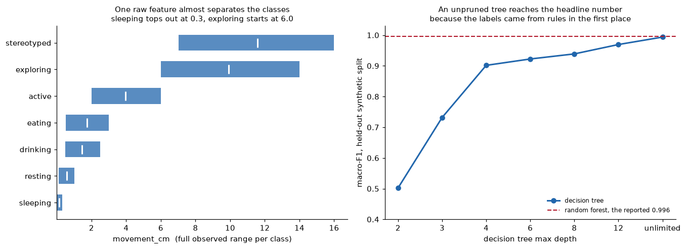
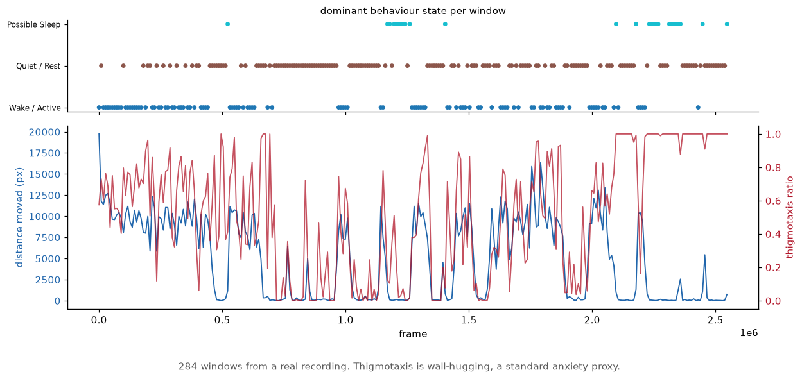
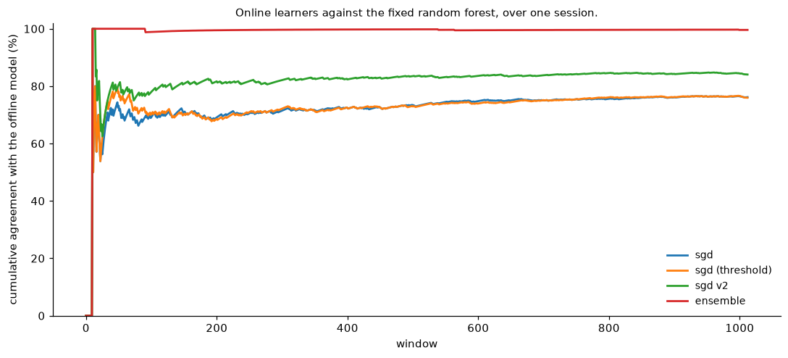
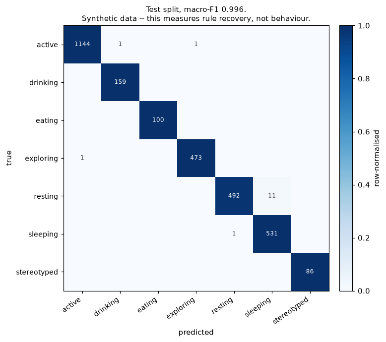
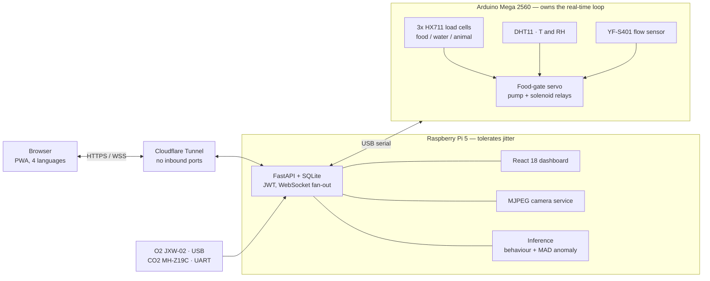

# Smart IVC cage, the software platform

[](https://doi.org/10.5281/zenodo.23003680)
[](https://github.com/aghasalim/smart-ivc-cage-platform/actions/workflows/ci.yml)

This is the software for an instrumented individually ventilated cage (IVC), the
kind used in lab animal research. It handles feeding, water dosing, load-cell
weighing, gas analysis, cameras and behaviour classification. It all runs on a
Raspberry Pi 5 next to the cage. You can reach it from anywhere, and it redeploys
itself within 60 seconds of a push.

We built it for our third-year Industry Project at Howest University of Applied
Sciences, for an outside client that makes animal-research equipment.

> This was a three-person team project, and this repo is a cleaned-up extract of
> it. I made 173 of 204 commits and was responsible for the backend, the
> dashboard, the device/firmware layer and the deployment pipeline. The
> behaviour-classification models were mostly a teammate's work, see
> [Attribution](#attribution). I removed client identifiers, meeting minutes, peer
> evaluations and production hostnames, so nothing here is confidential.

---

## The number I am not going to advertise

Our original report opens with macro-F1 0.996 for the behaviour classifier.
The number is real and you can reproduce it, but it means almost nothing. I think
explaining why is the most useful thing I learned on this project. The code in
`verify/` recomputes it, and every other measured figure below, from the raw
metrics, and CI fails the build if any of them disagree.

The classifier is trained and tested on a synthetic dataset made by
`ai/training/generate_dataset.py`. That's a generator we wrote by hand. It picks
labels from rules (mice are nocturnal, eat in bouts, sleep during the day), and the
model then learns those rules back. Testing on a held-out split from the same
generator only shows how separable the generator made its own classes. It says
nothing about classifying a real mouse.



On the left, you can see the generator gives each behaviour its own band of
`movement_cm`. Sleeping never goes above 0.3 cm, resting stops at 1.0, and exploring
starts at 6.0. On the right, an unpruned decision tree on those features reaches
macro-F1 0.9936. That's within 0.003 of the reported random-forest number. So the
classifier is just recovering the rules the generator wrote.

The model comparison points the same way, that the task is close to trivial.

| model | macro-F1 (held-out synthetic) |
|---|---:|
| random forest | 0.996 |
| hist gradient boosting | 0.996 |
| logistic regression | 0.935 |

Two unrelated model families get exactly the same score, and a linear model is
only six points behind. That's what a saturated benchmark looks like. On a really
hard tabular problem you'd expect them to spread out.

We never collected labelled data from real animals. The cage hardware and ethical
approval for live animals were outside the project's scope. So all I can honestly
claim is that the inference path is built, integrated and runs end to end. Its
accuracy on real behaviour hasn't been measured. What we delivered is the pipeline,
and the score doesn't prove anything.

I'd rather say this than have someone assume 0.996 means more than it does. With
animals and an ethics approval, it's the first thing I'd fix.

---

### Behaviour monitoring on real recordings



This is 284 ten-minute windows (about 47 hours) of real infrared footage of one
mouse, run through the same pipeline. The footage was given to us for the project.
It wasn't recorded on this cage. Thigmotaxis means wall-hugging, which is a common
anxiety proxy in rodent work. I track it next to movement because either one alone
is ambiguous.



The SGD variants update on the stream while the random forest stays fixed. In
practice I care whether the model running on the Pi stays close to the one I
checked offline.



I've included this for completeness. Read it with the separability figure above in mind.

## The engineering I would actually point at

### Volumetric water dosing, and why it runs open-loop

The firmware has closed-loop dosing, which I describe below. But on the assembled
cage the flow sensor picked up about 200 fake pulses per second from electrical
noise. That made the loop cut the pump almost straight away, and the water load
cell didn't track the reservoir either. So the dashboard doses open-loop. It runs
the pump for volume / rate seconds, with the rate calibrated on the scale
(4.5 mL/s), and hard limits on time and volume. The closed loop is ready for when
the sensor wiring gets fixed.

Giving a mouse an exact volume of water is harder than running a pump for N
seconds. If you get it wrong, the intake measurement the experiment depends on is
wrong too.

- A YF-S401 flow sensor (7.5 pulses/mL) counts what actually gets delivered.
- The pump stops early and coasts. Water in the pipe keeps moving after the pump
  cuts, so the controller subtracts the measured coast volume and hits the target
  without overshooting.
- A normally-closed solenoid valve shuts as soon as the pump stops. Without it,
  gravity siphons the tank through the line, and the "dose" quietly keeps going
  after the controller thinks it's done.
- If flow stalls mid-dose, the pump cycles itself to recover, so it never reports a
  dose that didn't arrive.

Each of these guards against data that looks fine but is wrong, which I think is
the worst kind of bug in an experiment.

### A DHT11 driver written from the datasheet

An earlier firmware (`device/arduino/valve_controller/`) talks to the
temperature/humidity sensor with my own implementation of the protocol, written
from the datasheet's single-wire timing. The current sketch
(`device/arduino/ivc_sensors/`) uses the standard DHT library instead. The timing
diagram is in [`docs/HARDWARE.md`](docs/HARDWARE.md).

### Cameras that survive more than one viewer

My first camera version returned 503s as soon as two dashboard sessions opened
the same stream, because each request tried to own the capture device. Now there's
one ffmpeg process per camera that stays running, with a shared frame cache. Viewers
read the same decoded frame and don't fight over the hardware.

### A deployment with no inbound ports

You reach the Pi at a public HTTPS hostname through a Cloudflare Tunnel. That
means no port forwarding and no inbound port open on the lab network, which
mattered because the device sits on a university network we don't control.
Deployment only pulls. A systemd timer polls the repo and redeploys within 60
seconds. The Pi never accepts a push and has no deploy endpoint, so breaking into
the pipeline doesn't give you the device.

### Security posture

Auth uses JWT bearer tokens, bcrypt hashing and constant-time checks, and the
login endpoint is rate-limited. The headers are HSTS, per-path CSP,
`X-Frame-Options: DENY`, `X-Content-Type-Options: nosniff`, Referrer-Policy,
Permissions-Policy, COOP and CORP. There's also an RFC 9116 `security.txt`. CI runs
`pip-audit` on every push.

---

## Architecture



The Mega handles anything with a deadline, and the Pi handles anything that can
wait. Load-cell calibration is stored in the Mega's EEPROM so it survives a power
cycle, and the dosing loop keeps going if the Pi reboots mid-experiment.

| layer | stack |
|---|---|
| firmware | Arduino Mega 2560 (C++), inline sensor protocols, EEPROM calibration |
| backend | FastAPI, SQLAlchemy, SQLite, JWT, WebSockets |
| frontend | React 18 + TypeScript + Vite, PWA, 4-language i18n |
| inference | scikit-learn (behaviour), MAD-based streaming anomaly detector |
| ops | Cloudflare Tunnel, systemd timers, pull-only auto-deploy, GitHub Actions |

You can export to CSV, JSON, XLSX, PDF and DOCX. Exports are streamed and
row-capped, so a researcher can pull a range straight into R or SPSS.

---

## Running it

```bash
cp .env.example .env      # then change every default password in it
docker compose up --build
```

The dashboard is at `http://localhost:5173`, the API at `http://localhost:8000`,
and the OpenAPI docs at `/docs`. The stack comes with a device simulator, so you
can run the whole platform end to end without any hardware. It feeds fake cages
through the same ingest API the Mega uses.

Backend tests:

```bash
cd backend && pip install -r requirements.txt pytest && pytest
```

There are 18 tests. 8 cover auth, role checks, security headers, the ingest
round-trip and health. The other 10 cover the feeding scheduler's time windows.

> The default credentials in `.env.example` are placeholders (`change-me-please`).
> They're only seeded on first boot, and you have to change them before any real
> deployment.

---

## Limitations

The behaviour classifier has never seen a real mouse (see above). The inference
path is real, but the accuracy figure doesn't carry over.

There's no live hardware in this repo. I left out the trained YOLO/tracking weights
(~43 MB) because they're a teammate's work and they're big. The behaviour model
file isn't committed either (`*.pkl` is git-ignored). A fresh clone uses a fixed
rule-based classifier until you run `ai/training/train.py` to make it.

I only tested with one cage. The data model and simulator handle many cages, but
we only ever built one physical cage, so multi-cage use hasn't been tested on
hardware.

It uses SQLite. That's fine for one Pi and one cage, but the write path would need
Postgres before this could scale to a rack.

---

## Attribution

We were three people working over one semester. These are the commit counts from
the original repo, which I think is the fairest evidence there is.

| contributor | commits | principal area |
|---|---:|---|
| **Aghasalim Mustafazada** (this account) | 173 | backend, dashboard, device/firmware, deployment, docs |
| **Gražvydas Stalmokas** | 29 | behaviour-classification models, multi-animal tracking |
| **Hadi Hleihel** | 2 |, |

In practice I wrote the FastAPI backend and its tests, the React dashboard, the
Arduino firmware and the device services on the Pi, and the camera service. I also
set up the Cloudflare Tunnel and the pull-only deploy pipeline, and wrote the docs.
The model-training code under `ai/training/` (the behaviour classifiers and the
YOLO multi-animal tracking) is mostly Gražvydas's work. My part there was the
real-time inference that runs it in the live loop (`ai/inference/`) and the
serving path in `backend/app/ai/`.

---

## References

This is a platform project, so the list is short. It's mostly standards and
datasheets the code follows.

- **Directive 2010/63/EU on the protection of animals used for scientific purposes.** [eur-lex.europa.eu/eli/dir/2010/63/oj](https://eur-lex.europa.eu/eli/dir/2010/63/oj) Any use with live animals would fall under this. The project never ran on live animals and never got ethical approval, which is why the behaviour accuracy here is unmeasured.
- **Leys, Ley, Klein, Bernard, Licata. Detecting outliers: Do not use standard deviation around the mean, use absolute deviation around the median. Journal of Experimental Social Psychology 49, 2013.** [doi:10.1016/j.jesp.2013.03.013](https://doi.org/10.1016/j.jesp.2013.03.013) The median absolute deviation rule used by the anomaly detector.
- **Component datasheets: HX711 load cell amplifier, DHT11 temperature and humidity sensor, MH-Z19C NDIR CO2 sensor, JXW-02 electrochemical O2 sensor.** I took the calibration constants and sampling limits in the firmware from these.

## Licence

MIT, see [LICENSE](LICENSE). I removed the client's identity, meeting minutes,
peer evaluations, production hostnames and default credentials from this extract.
