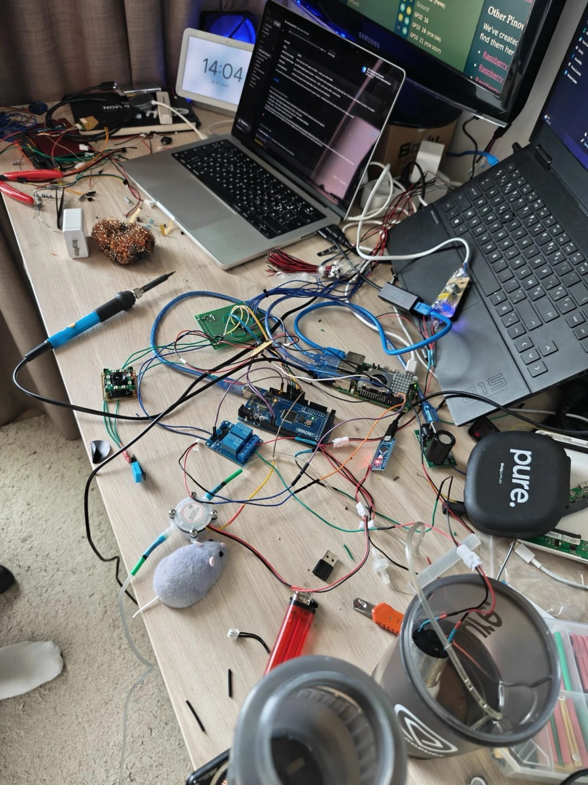
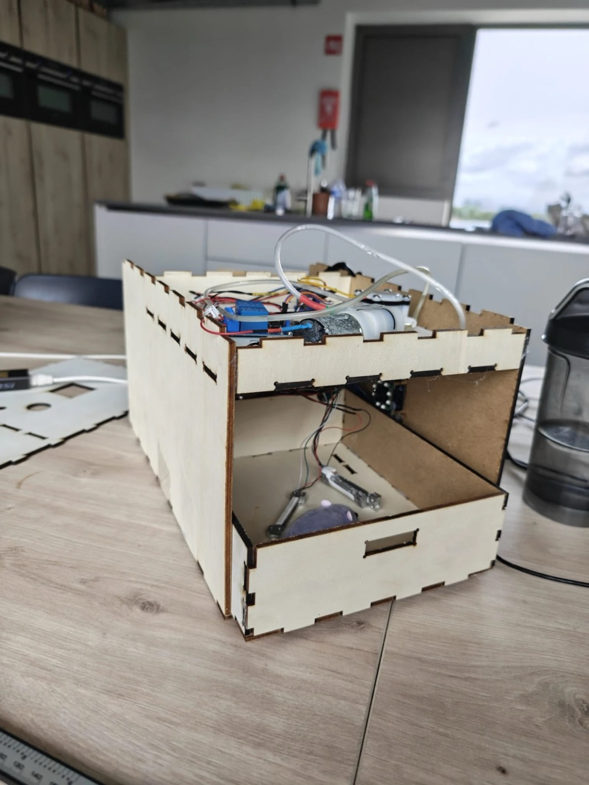
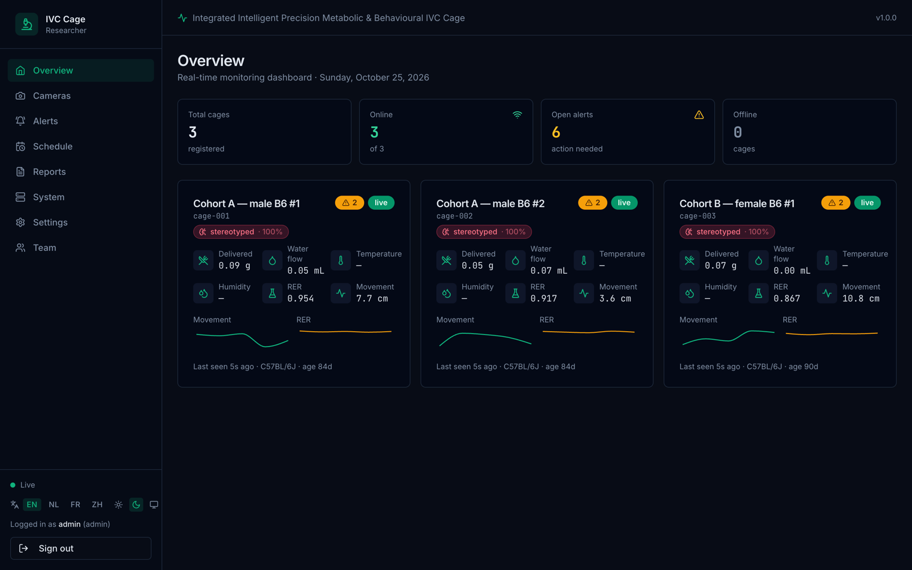
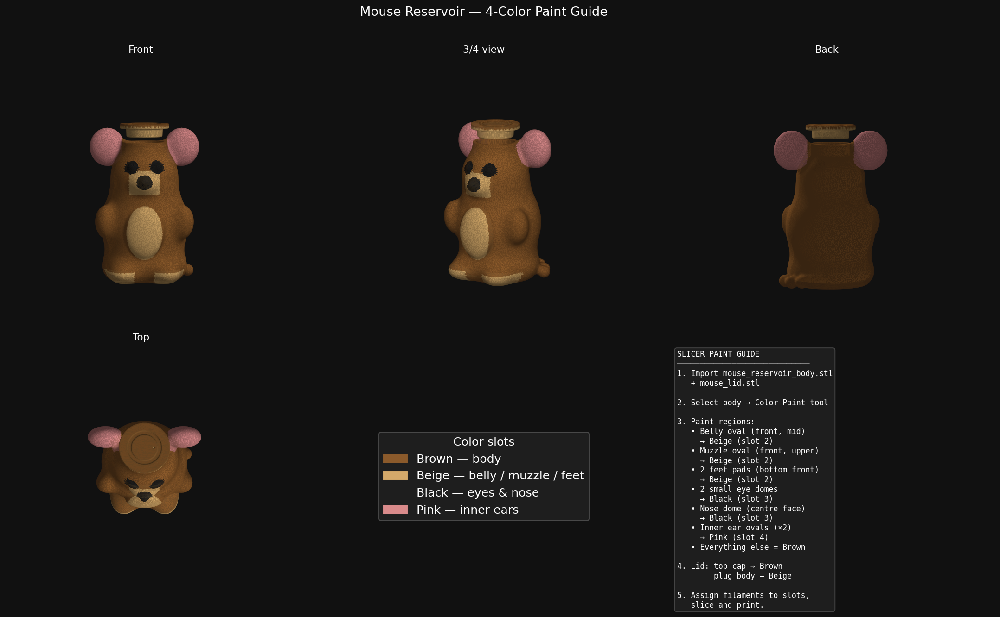
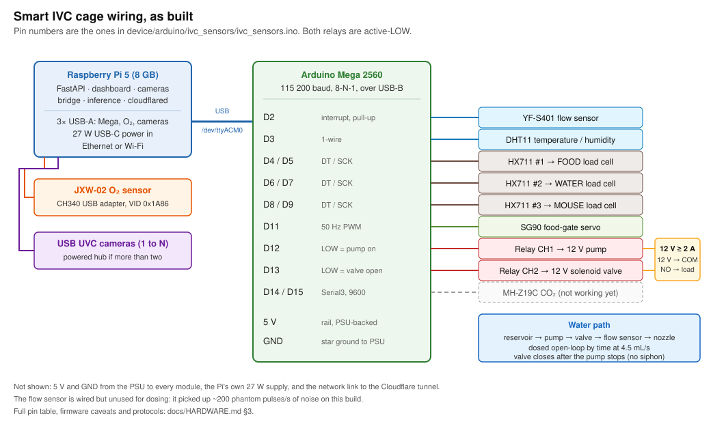
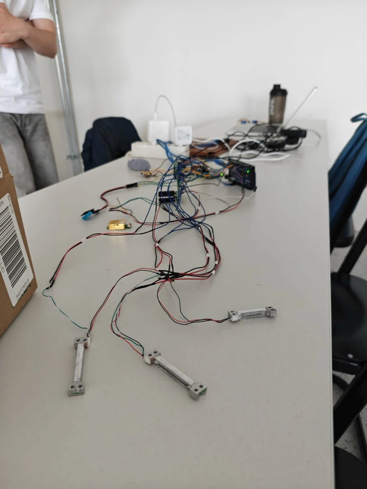
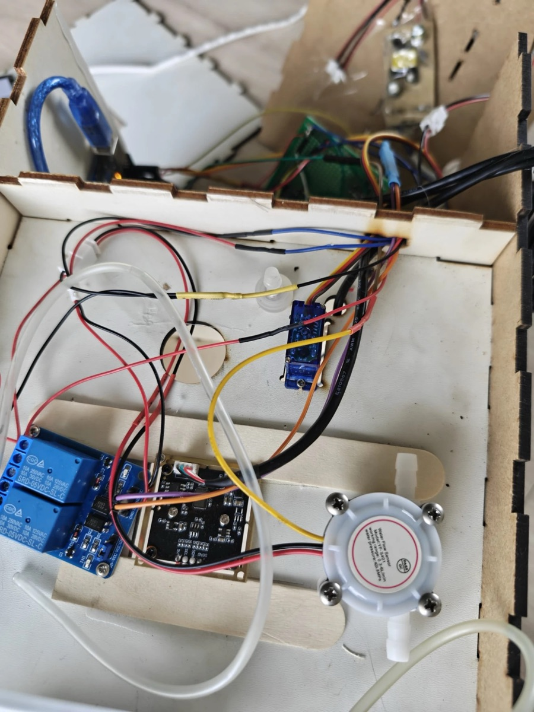
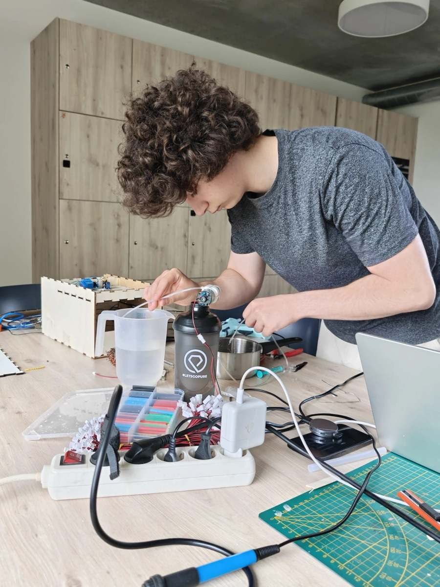
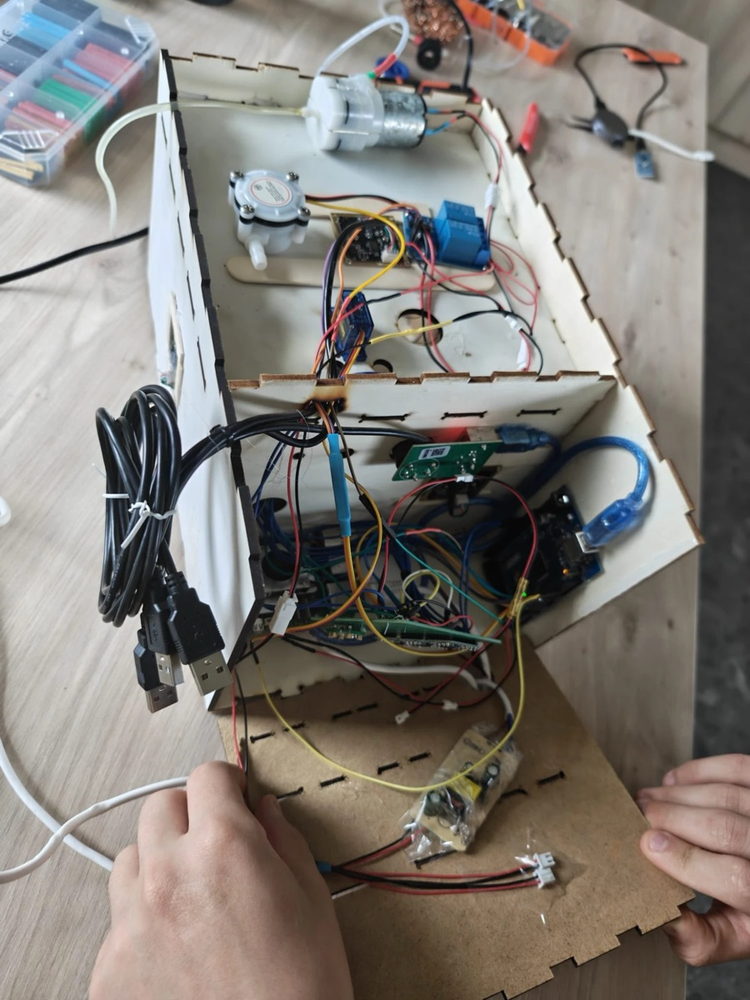

# Build guide

How to make one of these from a box of parts. Five stages, each ending in a
check you can do in under a minute, so you know the stage worked before you
start the next. Budget a weekend for the first build.

Parts and prices are in [BILL_OF_MATERIALS.md](BILL_OF_MATERIALS.md). Every pin,
protocol and firmware caveat is in [HARDWARE.md](HARDWARE.md); this page only
tells you the order to do things in. When something doesn't work, go to
[TROUBLESHOOTING.md](TROUBLESHOOTING.md).

```
stage 0  software, no hardware     → dashboard shows three simulated cages
stage 1  print                     → reservoir holds water overnight
stage 2  wire the Mega             → JSON lines on the serial monitor
stage 3  flash and calibrate       → the scale reads your reference mass
stage 4  the Pi                    → the dashboard shows your cage, online
stage 5  water, food, cameras      → a 10 mL dose lands within 1 mL
```

<p align="center"> </p>

---

## Stage 0: run it with no hardware

Do this first, on your laptop. It proves the software side and gives you a
dashboard to watch the real cage appear in later.

```bash
git clone https://github.com/aghasalim/smart-ivc-cage-platform.git
cd smart-ivc-cage-platform
cp .env.example .env     # set JWT_SECRET to any 32+ character string
make up                  # docker compose up --build
```

**Check:** `http://localhost:5173`, log in as `researcher` / `change-me-please`,
and the Overview shows three cages with values that change every five seconds.
Those come from the simulator; it posts the same packet the real cage will.

<p align="center"></p>

---

## Stage 1: print the reservoir

Files are in [`device/mouse-reservoir/`](../device/mouse-reservoir/): the body,
the lid, and a four-colour paint guide for the slicer.

| Setting | Body | Lid |
|---|---|---|
| Material | PETG (food-contact grade) | PETG |
| Layer height | 0.2 mm | 0.2 mm |
| Perimeters | 4 | 3 |
| Infill | 100 % (it holds water) | 30 % |
| Top/bottom layers | 6 | 5 |
| Supports | none, print upright on the flat base | none, flat side down |
| Flow | 103 to 105 % for a tighter wall | default |
| Colours | brown body, beige belly/muzzle/feet, black eyes and nose, pink inner ears | brown cap, beige plug |

These are starting points, not the settings the originals were printed with;
those weren't recorded. Water-tightness is the only thing that matters. If a
single-material print seeps, a coat of food-safe epoxy on the inside or a
longer (slower, hotter) print fixes it. The slicer paint steps are in the
folder's README and the picture below.

<p align="center"></p>

**Check:** fill it, put it on a paper towel, leave it overnight. Dry towel
means move on. Fit the lid and tip it; the lid should hold without a seal.

---

## Stage 2: wire the Arduino Mega

Lay it out flat on the bench before anything goes in the enclosure. The
photo above left is what ours looked like at this stage.

<p align="center"></p>

Order of wiring, easiest to test first:

1. **Power rails.** 5 V and GND from the Mega to a breadboard rail; every
   module takes its 5 V from there. Separate 12 V supply for the pump and valve,
   grounds joined at one point (star), never through the Mega.
2. **DHT11** data to D3. Keep the lead under 20 cm.
3. **HX711 ×3.** DT/SCK to D4/D5 (food), D6/D7 (water), D8/D9 (mouse). The
   four-wire load cell goes to E+/E−/A+/A− on each HX711; red is usually E+,
   black E−, white A−, green A+.
4. **Servo** signal to D11, power from the 5 V rail.
5. **Relay module.** IN1 to D12 (pump), IN2 to D13 (valve). 12 V to COM on
   both channels, each load to NO. Active-LOW: the Mega pulls the pin LOW to switch on.
6. **Flow sensor** signal to D2. Leave it in, but read §3.2 of HARDWARE.md:
   on our build it counted ~200 phantom pulses a second from noise, so dosing
   ended up open-loop by time.
7. **O₂ sensor** goes to the Pi over USB (CH340), not the Mega. Skip it for now.

The full pin table, with the three firmware-versus-comment caveats, is
[HARDWARE.md §3.1](HARDWARE.md#31-arduino-mega-pin-map).

<p align="center"> </p>

**Check:** nothing is flashed yet, so the check is visual: no module shares a
pin with another, the relay LEDs are off, and the 12 V rail is not connected to
anything on the 5 V side. Then plug the Mega into your laptop and move on.

---

## Stage 3: flash and calibrate

```bash
arduino-cli core install arduino:avr
arduino-cli lib install "HX711 Arduino Library" "DHT sensor library" "Adafruit Unified Sensor"
arduino-cli compile --fqbn arduino:avr:mega device/arduino/ivc_sensors
arduino-cli upload  --fqbn arduino:avr:mega -p /dev/ttyACM0 device/arduino/ivc_sensors
arduino-cli monitor -p /dev/ttyACM0 -c baudrate=115200
```

On macOS the port is `/dev/cu.usbmodem*`; on a clone board, `/dev/ttyUSB0`.

You should see one JSON line per second with temperature, humidity and three
raw masses. The firmware only acts on complete `{...}` JSON frames, so line
noise can't trigger the pump:

| Send | Does |
|---|---|
| `{"tare":1}` | tare all three scales |
| `{"calibrate":1}` | guided calibration: it asks for a known mass per cell and stores the factor in EEPROM |
| `{"pump":"on","dur":2000}` | pump for 2 s |
| `{"dose":10}` | metered 10 mL dose (uses the flow sensor; see the note above) |
| `{"servo":"food","angle":90}` | open the food gate (0 closes it) |
| `{"status":1}` | dump calibration and state |

Calibration survives a power cycle; it's behind magic word `0x49564341` in EEPROM.

<p align="center"></p>

**Check:** put a known mass (a full 500 mL bottle is 500 g ± a few) on each
platform after calibrating. The serial line should read it within 1 g. Tare,
lift it off, and the reading returns to 0 ± 0.5 g.

---

## Stage 4: the Raspberry Pi

Flash Raspberry Pi OS 64-bit, enable SSH, then on the Pi:

```bash
git clone https://github.com/aghasalim/smart-ivc-cage-platform.git ~/IndustryProject
cd ~/IndustryProject
```

Four services run here, each in its own folder under `device/` and `backend/`
with an `env.example` and a `.service` unit:

| Service | Folder | Reads | Talks to |
|---|---|---|---|
| `ivc-backend` | `backend/` | SQLite | the dashboard |
| `ivc-arduino-bridge` | `device/arduino-bridge/` | the Mega on USB | `POST /api/v1/ingest` |
| `ivc-cameras` | `device/camera-stream/` | `/dev/video*`, the dosing commands | MJPEG on `:8090`, serial to the Mega |
| `ivc-env-ingester` | `device/env-ingester/` | the DHT11 via the camera service | `POST /api/v1/ingest` |

For each one: `python3 -m venv .venv && .venv/bin/pip install -r requirements.txt`,
copy `env.example` to `.env`, then `systemctl --user enable --now <unit>` after
linking the unit file into `~/.config/systemd/user/`. The env ingester ships
without a unit file; copy `ivc-arduino-bridge.service` and change the paths.

The bridge needs three values in its `.env`:

```ini
BACKEND_URL=http://localhost:8000
CAGE_ID=cage-001            # create this cage in the dashboard first
API_KEY=ivc_...             # dashboard → Settings → API Keys → New key
```

Then plug the Mega into the Pi. Make sure the Mega is on `/dev/ttyACM0` (`ls /dev/ttyACM*`).

Optional, but it's how the real one runs: `scripts/pi-deploy.timer` polls
GitHub every 60 s and redeploys on a push to `main`, and `cloudflared` opens an
outbound tunnel so nothing needs a port forwarded. Both are described in
[HARDWARE.md §11](HARDWARE.md#11-reproducibility) and [architecture.md §5.2](architecture.md).

<p align="center"></p>

**Check:** `journalctl --user -u ivc-arduino-bridge -f` shows a `202` every
5 s, and the cage card on the dashboard turns from grey (offline) to green
with your real temperature on it. `curl localhost:8000/health` says `ok`.

---

## Stage 5: water, food, cameras

Now the parts that touch the animal side.

**Water.** Tubing from the reservoir through the pump, then the valve, then
the nozzle. Prime it with `{"pump":"on","dur":3000}` while holding the nozzle
below the reservoir. The dashboard doses by time at 4.5 mL/s
(`DOSE_RATE_ML_S` in the camera service's `.env`); that figure came from
weighing a 2 s pulse on the water scale, and you should repeat it for your pump:

1. put a cup on the water load cell and tare (`{"tare":1}`)
2. dose 10 mL from the dashboard
3. read the mass; your rate is `4.5 × 10 / measured_g`
4. set `DOSE_RATE_ML_S` to that and restart `ivc-cameras`

**Food.** Mount the SG90 so 0° closes the hopper gate and 90° opens it. The
feeding scheduler in the backend opens it on the windows you set in the
dashboard's Schedule page.

**Cameras.** USB UVC cameras appear as `/dev/video0`, `/dev/video2`, … (every
other index). Set `VITE_PI_STREAM_URL=http://<pi>:8090` where the frontend is
built, and the Cameras page streams them. More than two cameras wants a
powered hub.

**Check:** dose 10 mL three times onto the tared water scale; each lands
within 1 mL. Open the gate from the dashboard and watch the servo. Open the
Cameras page and see yourself.

---

## What you now have, and what you don't

You have the cage we built: sensing, dosing, feeding, cameras, a dashboard,
and a behaviour classifier that runs but has never seen a real mouse. Before
any live animal goes in, read the README's *Limitations* and the
EU Directive 2010/63 reference at the bottom of it; this build never had
ethical approval and was only ever run on the bench.

If you record labelled behaviour on it, that's the single most useful thing
anyone could contribute; see [`ai/data/DATASET.md`](../ai/data/DATASET.md).
